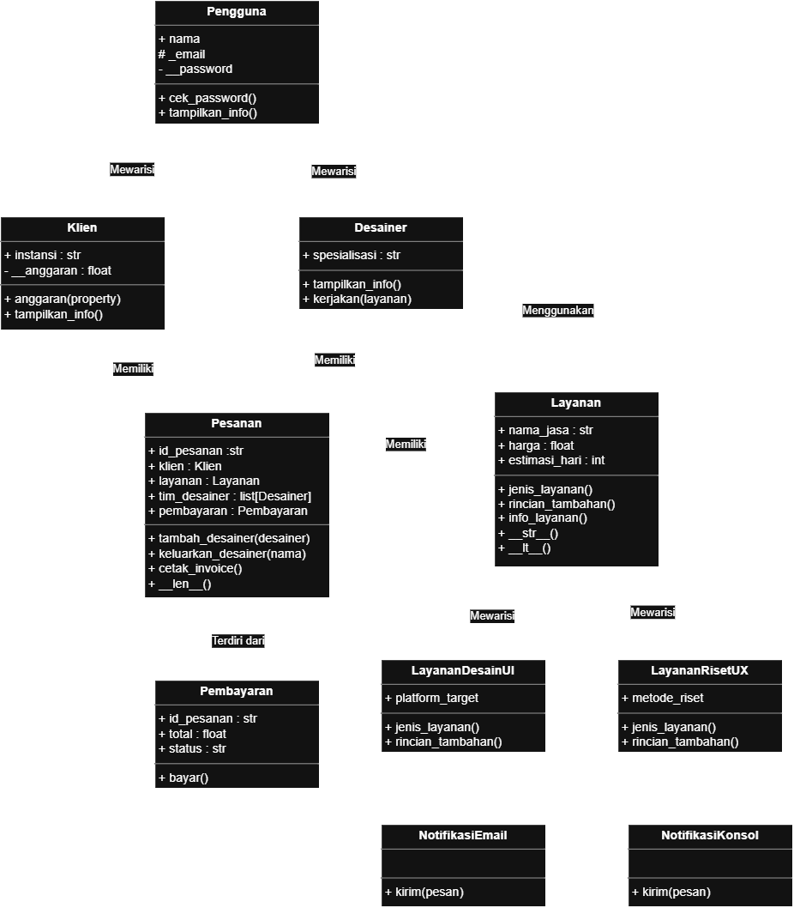

# Sistem Manajemen Pemesanan Jasa Desain UI/UX pada Studio Digital

## 1. Deskripsi Program

Program ini memodelkan proses pemesanan jasa desain UI/UX pada MondayCraft Studio. Fitur utamanya meliputi pengelolaan pengguna, klien, desainer, layanan desain UI dan riset UX, pesanan, invoice, pajak, serta status pembayaran.

Program juga menunjukkan penerapan konsep Pemrograman Berorientasi Objek (PBO), yaitu inheritance, enkapsulasi, abstraksi, polimorfisme, relasi antarkelas, dan prinsip SOLID. Ketika dijalankan, program menampilkan contoh penggunaan fitur-fitur tersebut di terminal.

### Cara Menjalankan

Pastikan Python 3.9 atau versi lebih baru telah terpasang. Program hanya menggunakan standard library Python sehingga tidak memerlukan instalasi paket tambahan.

```bash
python main.py
```

## 2. Class Diagram UML`



### Relasi Antarkelas

**Asosiasi — `Desainer` menggunakan `Layanan`.** Method `Desainer.kerjakan(layanan)` menerima objek layanan sebagai parameter dan menggunakannya saat method dipanggil. Objek layanan tidak disimpan sebagai atribut permanen oleh desainer, sehingga keduanya tetap dapat digunakan secara mandiri.

**Agregasi — `Pesanan` memiliki `Klien`, `Layanan`, dan `Desainer`.** Objek klien dan layanan diberikan dari luar melalui konstruktor `Pesanan`, sementara desainer dibuat secara mandiri lalu ditambahkan ke tim pesanan. Hubungan ini tidak memiliki kepemilikan eksklusif; objek-objek tersebut tetap dapat hidup ketika pesanan dihapus selama masih memiliki referensi lain.

**Komposisi — `Pesanan` terdiri dari `Pembayaran`.** Objek `Pembayaran` dibuat langsung oleh konstruktor `Pesanan` untuk pesanan tersebut. Kepemilikan ini lebih kuat daripada agregasi karena siklus hidup pembayaran bergantung pada pesanan; jika pesanan dihapus dan tidak ada referensi lain ke pembayaran, objek pembayaran dapat dibersihkan oleh Python.

## 3. Abstraksi (*Abstract Base Class*)

- **Abstract class:** `Layanan`, yang mewarisi `ABC` dari modul `abc`.
- **Abstract method:** `jenis_layanan()` dan `rincian_tambahan()`, keduanya menggunakan dekorator `@abstractmethod`.
- **Method konkret:** `info_layanan()` menampilkan informasi layanan umum dan menggunakan method yang diimplementasikan subclass. Kelas ini juga menyediakan `__str__()` dan `__lt__()`.
- **Subclass konkret:** `LayananDesainUI` mengimplementasikan kedua abstract method dan memiliki atribut khusus `platform_target`. `LayananRisetUX` juga mengimplementasikannya dan memiliki atribut khusus `metode_riset`.
- **Bukti abstract class tidak dapat diinstansiasi:** program mencoba membuat objek `Layanan(...)` dalam blok `try-except TypeError`. Pesan error ditampilkan di terminal karena kedua abstract method belum memiliki implementasi pada kelas dasar.

Abstraksi digunakan dalam alur program: pesanan menerima objek layanan dari kelas abstrak `Layanan`, sedangkan jenis layanan dan rincian khusus ditentukan oleh implementasi subclass masing-masing.

## 4. Polimorfisme

### a. Polimorfisme melalui Pewarisan

`Klien` dan `Desainer` adalah subclass `Pengguna` yang meng-*override* method `tampilkan_info()` dengan perilaku berbeda. Program menempatkan objek `Pengguna`, `Klien`, dan `Desainer` dalam satu daftar, lalu memanggil `tampilkan_info()` melalui satu perulangan. Setiap objek menjalankan implementasinya sendiri tanpa pemeriksaan tipe objek.

### b. Duck Typing

`NotifikasiEmail` dan `NotifikasiKonsol` tidak memiliki hubungan pewarisan satu sama lain, tetapi keduanya menyediakan method `kirim(pesan)`. Fungsi `kirim_notifikasi(kanal, pesan)` cukup memanggil `kanal.kirim(pesan)` tanpa memeriksa tipe objek. Pengiriman email pada contoh ini merupakan simulasi dan tidak mengirim email sungguhan.

### c. Operator Overloading

- `Layanan.__lt__()` memungkinkan operator `<` membandingkan harga dua layanan dan menghasilkan nilai boolean.
- `Layanan.__str__()` menyediakan representasi teks ketika objek ditampilkan dengan `str()` atau `print()`.
- `Pesanan.__len__()` membuat `len(pesanan)` mengembalikan jumlah desainer yang sedang ditugaskan.

Program tidak menggunakan rantai `if/elif` yang memeriksa `type()` atau nama kelas untuk menentukan perilaku polimorfik.

## 5. Bukti Output Eksekusi

Screenshot berikut menunjukkan output aktual program saat `python main.py` dijalankan, termasuk overriding, error saat abstract class diinstansiasi, penggunaan asosiasi/agregasi/komposisi, invoice dan pembayaran, duck typing, serta operator overloading menggunakan ekstensi vscode bernama TermSnap.


## 6. Prinsip SOLID

Program menerapkan **Open/Closed Principle (OCP)** pada hierarki `Layanan`. Jenis layanan baru dapat ditambahkan sebagai subclass yang mengimplementasikan abstract method tanpa perlu mengubah alur umum pemesanan dan pencetakan invoice. Dengan demikian, fitur layanan dapat diperluas tanpa menambahkan percabangan berdasarkan nama atau tipe layanan.

## Isi Paket

Paket ini terdiri dari empat berkas:

```text
main.py
readme.md
classdiagram.png
screenshot.png
```
